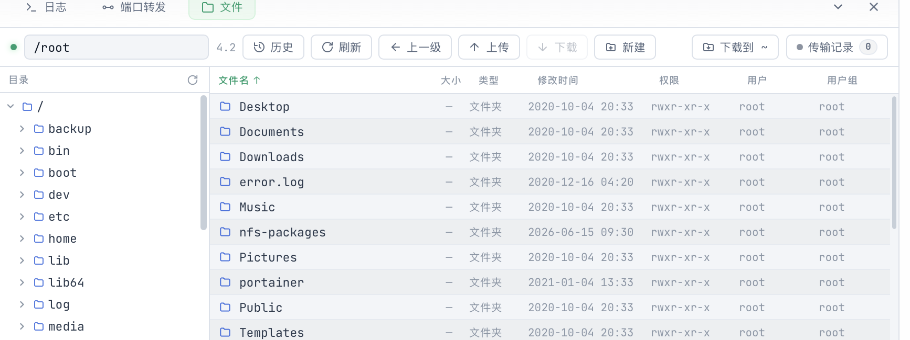

# SFTP 文件传输

> description: Rhost 内建 SFTP 文件管理器的文件浏览、拖拽上传下载、外部编辑器协同回写、断点续传与队列管理
>
> created: 2026-10-09 19:31:50
>
> updated: 2026-11-04 09:31:42
>
> author: [sjzhao](https://github.com/ShiJieCloud/rhost)

## 1. 入口

- 标签右键 → 「打开「文件」面板（SFTP）」
- 工作台底部 Dock → 「文件」标签
- 命令面板（`⌘K`）→ 「打开「文件」面板（SFTP）」

「文件」面板复用当前 SSH 连接的 SFTP 子系统，无需额外认证。

## 2. 文件浏览

面板自上而下是**顶栏**与**主体**两段。顶栏三段式：左侧是当前远程目录（可直接编辑的输入框）与主机标识，正中一组工具（历史 / 刷新 / 上一级 / 上传 / 下载 / 新建），右侧是下载落点「下载到」和「传输记录」。主体左窄右宽：左边是**远程目录树**，右边是**文件列表**，中间的分隔线可拖拽调宽（宽度记住，双击分隔线恢复默认）。

本机侧默认不占一栏：上传走顶栏「上传」或把文件拖进文件区，下载落点由「下载到」指定。需要老的双栏布局时，在 全局设置 → SFTP → 浏览 打开「显示本机文件栏」即可恢复，本机侧那一栏自带路径、上一级、刷新、新建与上传按钮。

### 2.1 文件信息

每条文件/目录展示以下信息（列名与 FinalShell 的「文件」页一致）：

| 列 | 说明 |
|---|---|
| 文件名 | 目录与文件分块排列，目录在前；列头带 ↑/↓/↕ 排序标记 |
| 大小 | 文件字节数，按量级显示（`B`/`KB`/`MB`/`GB`）；目录显示 `—` |
| 类型 | `文件夹` / `文件` / `链接` / `字符设备` / `块设备` / `管道` / `套接字` |
| 修改时间 | mtime，`YYYY-MM-DD HH:MM` |
| 权限 | 如 `rwxr-xr-x`（setuid/setgid/sticky 显示为 `s`/`t`） |
| 用户 | 属主名 |
| 用户组 | 属组名 |

- 「类型」取服务端 `ls -l` 风格 longname 的首字符；个别 sshd 的 NAME 响应不带 longname 时按目录/文件兜底显示，不会瞎猜成设备文件。
- 「用户」「用户组」同样优先取 longname 里的名字，缺失时回退成数字 uid/gid（与 FileZilla 等客户端一致）；本机栏走 `getpwuid`/`getgrgid` 反查，Windows 上这两列为空。
- 只有 文件名 / 大小 / 修改时间 三列可排序，点列头切换升降序；类型、权限、用户、用户组是信息列。
- 行底色按奇偶交替（斑马纹），列多时横向扫读不串行；悬停与选中色压过条纹。

### 2.2 目录导航

| 操作 | 方式 |
|---|---|
| 进入目录 | 双击列表里的目录，或在左侧目录树点它 |
| 返回上级 | 顶栏「上一级」 |
| 跳转路径 | 在顶栏路径条输入绝对路径回车（`Esc` 或失焦回正到当前目录） |
| 回选最近目录 | 顶栏「历史」下拉，列出本次连接内成功进入过的目录（最多 30 条，当前所在项标绿） |
| 展开下一层 | 点树里的三角；树只列目录、按需加载，展开过才发一次列举 |
| 刷新 | 顶栏「刷新」（本机与远端同时重载），树另有单独的重载按钮 |

树与列表双向跟随：列表换了目录，树上那条路径自动摊开并高亮；在终端里 `cd` 后（后端经 SSH 通道上报新 CWD），列表和树一起跳过去。树与文件列表用同一套「显示隐藏文件」规则，不会出现树里点得到、列表里却看不到的目录。

反向同步是静默的：在 SFTP 面板里切目录时，后端向 Shell 注入的 `cd` 不会回显到终端，旧提示符被就地擦除、新目录的提示符落在同一行——看不到 `cd` 命令，也不会多出一行空行。手动在终端敲的命令不受影响，照常回显。

### 2.3 文件操作

本地与远端两侧支持大部分相同的文件操作（「修改权限」只挂远端栏）：

| 操作 | 说明 |
|---|---|
| 新建文件夹 | 顶栏「新建」，或空白处右键 → 新建文件夹，行内输入名称 |
| 新建文件 | 空白处右键 → 新建文件，行内输入名称 |
| 重命名 | 右键 → 重命名，行内编辑 |
| 修改权限 | 远端栏右键 → 修改权限，见 2.7 |
| 删除 | 右键 → 删除 |
| 复制 / 剪切 | 右键，支持同侧复制、跨侧传输 |
| 用编辑器打开 | 远端栏右键，见 2.6 |
| 上传 | 顶栏「上传」（系统文件面板选本机文件），或右键，或直接把文件拖进文件区（见 2.4） |
| 下载 | 选中条目后点顶栏「下载」（未选中时按钮灰显），或右键 |

> 跨侧剪切粘贴：传输成功后自动删除源文件。

### 2.4 拖拽上传文件与文件夹

把访达 / 资源管理器里的条目直接拖进文件区即可上传到**当前远端目录**，支持一次拖入多个文件与多个文件夹混排：

| 拖入 | 落点 |
|---|---|
| 文件 | 当前远端目录下的同名文件 |
| 文件夹 | 当前远端目录下的同名目录，整棵递归复刻（含空目录） |

- 只有落在文件区主体内才会触发上传：拖到 AI 聊天附件区等别的位置保持原样，不会被当成上传。
- 文件夹的目录骨架由一次 `sftp_mkdir_all` 建好，几百个文件的目录不会退化成几百次逐级试建。
- 命中上传黑名单（`sftpBlacklist`）的文件跳过并入日志；单个目录建骨架失败只作废那一项，其余照常排队。
- 目录条目过多时后端会拒绝并提示缩小范围，避免一次拖入整个磁盘。

### 2.5 下载文件与文件夹

选中条目后点顶栏「下载」，任务落到**本机当前目录**——由顶栏「下载到 ~」按钮用系统目录面板指定，选定后本机路径随之切换（本机文件栏默认隐藏，这里是唯一指定落点的地方）。

| 选中 | 落点 |
|---|---|
| 文件 | 本机当前目录下的同名文件 |
| 文件夹 | 本机当前目录下的同名目录，整棵递归复刻（含空目录） |

- 目录树由后端一次 `sftp_walk` 枚举（与上传方向的 `local_walk` 对称），本地骨架由一次 `local_mkdir_all` 建好，几百个文件的目录不会退化成几百次试建。
- 子孙中的符号链接与设备 / 管道 / 套接字一律跳过：跟随链接可能成环，特殊文件读不完。
- 层级超过 64 层或文件数超过 5000 时后端拒绝并提示缩小范围，避免一次下载整棵 `/var`。
- 单个目录枚举或建骨架失败只作废那一项，其余选中项照常排队。

### 2.6 用本机编辑器编辑远端文件

远端栏右键 → 「用编辑器打开」（多选可批量；快捷键 `⌘↵`）。用哪个程序由 全局设置 → SFTP → 编辑器命令 决定：点「选择程序」从系统探测到的文本程序里挑（VS Code、Cursor、Sublime、Xcode、TextEdit 这类，可搜索），点「按路径选择…」直接指到任意程序或 `.app` 包，也可以自己写命令加参数；留空则按 `code` → `codium` → `cursor` → 系统默认顺序自动探测。

流程：远端文件取回一份临时副本（`<临时目录>/rhost-edit/<会话>/<远端目录哈希>/<文件名>`）→ 交给编辑器 → 编辑器里每次保存都会自动回写远端，队列里出现一条「回写 xxx」任务。

- 副本按远端目录分组存放，保留原文件名（编辑器据此选语法高亮），不同目录的同名文件互不覆盖。
- 回写**无视覆盖策略**强制写入：副本就是要落回原文件，不能被「跳过」策略静默拦下。
- 远端在编辑期间被改动（或被删除）时不静默覆盖：弹窗给出「仍然覆盖 / 放弃回写」，选放弃则本机副本仍在临时目录里，可手动处理。
- 会话关闭或重连换掉后端连接后停止跟踪，临时副本保留。
- 单个文件超过 32 MB 不取回（编辑器打开这种文件通常也没有意义），会直接报错。

### 2.7 修改远端文件权限

远端栏右键 → 「修改权限」（仅单选条目）弹出与 FinalShell 同形态的对话框：

| 区块 | 说明 |
|---|---|
| 所有者 / 组 / 其他 | 各自的 读取 / 写入 / 执行 勾选，即 `chmod` 三位八进制数的每一位 |
| 左下角读数 | 实时显示勾选对应的八进制（如 `755`）与符号写法（`rwxr-xr-x`），与列表「权限」列同一套写法 |
| 递归设置子目录 | 仅目录可勾（文件条目上灰显并注明「文件无需递归」）；勾选后才可选作用范围 |
| 作用范围 | 应用到文件和目录 / 只应用到文件 / 只应用到目录 |

- 打开时按条目当前权限回填勾选；权限位没变且没开递归时「确定」不可点。
- 只覆盖低 9 位：setuid / setgid / sticky（列表里显示成 `s`/`t` 的那一位）不参与勾选，改完会回落成普通 `x`/`-`。
- 递归逐项执行，任一项失败立即中断并报错，已改的部分保持不回滚（与 `chmod -R` 一致）；无论成败列表都会刷新为远端实际状态。
- 符号链接：直接对它执行「修改权限」改的是它**指向的目标**（服务端以 `chmod(2)` 落盘，链接自身权限恒为 `777`），对话框会给出提示；递归时子项里的符号链接一律跳过，不会顺链改到目录或指回上层的环。
- 改属主/属组不在面板能力内（SFTP 的 SETSTAT 改 uid/gid 依赖服务端实现），请在终端用 `chown`。

## 3. 传输记录

所有上传/下载任务进入传输队列，按「全局最大并发 / 单主机最大并发」两个上限放行（设置 → SFTP → 并发与限速），默认单主机 1，表现为串行。

队列面板不再常驻底部：SFTP 顶栏的「传输记录」按钮点开一个锚在右上角的浮层（宽 460px，随面板高度自适应，任务多时内部滚动），点浮层外或按 `Esc` 收起。收起状态下按钮仍常驻显示活动指示灯、任务数与一行进度摘要（如 `↑ app.tar 42% · 3.1 MB/s`、`已暂停 2 项`、`1 项失败`），入队与完成都不会自动弹出浮层，避免遮挡文件区。

浮层头部保留批量操作：全部暂停 / 全部继续 / 清空已完成 / 关闭。

### 3.1 任务状态

| 状态 | 颜色 | 说明 |
|---|---|---|
| pending | 灰 | 等待中 |
| running | 蓝 | 传输中 |
| paused | 橙 | 已暂停 |
| success | 绿 | 已完成 |
| error | 红 | 失败 |

### 3.2 队列操作

| 操作 | 作用 |
|---|---|
| 暂停 | 暂停运行中的任务（pending 任务不变） |
| 继续 | 恢复已暂停的任务 |
| 取消 | 取消 pending 或 running 的任务 |
| 重试 | 失败任务重新加入队列 |
| 打开目录 | 下载完成 → 在系统文件管理器里定位到刚落地的文件；上传完成 → 关闭浮层并把远端面板导航到该目录（远端目录本机打不开） |
| 清除已完成 | 移除所有 success 状态的任务 |

队列支持筛选：全部 / 上传 / 下载 / 已完成。

### 3.3 进度展示

每个任务展示：
- 进度百分比与进度条
- 实时传输速率（B/s，由后端进度事件提供）
- 已用时间

传输完成后自动刷新对侧目录，免去手动刷新。

## 4. 断点续传

设置项 `sftpResume` 开启后，传输中断后再次发起同名文件任务时，从已传输位置继续，无需从头重传。

- 关闭后，所有文件每次都完整从头传输
- 断点校验方式（`sftpResumeCheck`）用于续传前确认半截文件未被改动，可选文件大小 / 大小+mtime / SHA256 哈希

## 5. 传输设置

传输块大小、文件覆盖策略、断点续传等参数统一在「全局设置」中配置。详见 [全局设置](../reference/global-settings.md)。

## 6. 下一步

- [SSH 终端](./ssh-terminal.md)：终端使用指南；
- [全局设置](../reference/global-settings.md)：SFTP 传输参数配置；
- [主机与密钥管理](./host-management.md)：主机列表与连接配置。
